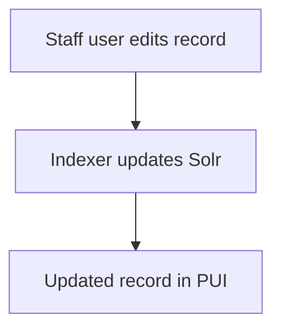

De Tech Docs-site bevat twee soorten content: documentatiepagina's en blogberichten. Beide soorten content worden geschreven in [Markdown](https://en.wikipedia.org/wiki/Markdown) en bevatten paginaspecifieke gegevens als [yaml](https://yaml.org/)-sleutel-waardeparen.

Tech Docs gebruikt [GitHub-flavored Markdown](https://github.github.com/gfm/), een variant van de Markdown-syntaxis, en [SmartyPants](https://daringfireball.net/projects/smartypants/), een plug-in voor typografische interpunctie. Deze hulpmiddelen bieden auteurs handige functies, zoals het genereren van aanklikbare links uit tekst, het maken van lijsten en tabellen en het opmaken van citaten en gedachtestreepjes.

## Waar pagina's staan

### Documentatiepagina's

Documentatiepagina's staan in `src/content/docs/`. Elke pagina is een `.md`- of `.mdx`-bestand. Het URL-pad bestaat uit `/` plus het bestandspad relatief aan die map, zonder de extensie. Zo wordt `src/content/docs/architecture/public.md` aangeboden op `/architecture/public`. Geneste mappen voegen segmenten aan het pad toe.

### Blog

Blogberichten staan als `.md`- of `.mdx`-bestanden in `src/content/blog/`. De URL bestaat uit `/blog/` plus het pad naar het bestand relatief aan die map, zonder de extensie. Zo wordt `src/content/blog/v4-2-0-release-candidate.md` aangeboden op `/blog/v4-2-0-release-candidate`. Geneste mappen voegen segmenten aan de URL toe.

Voor het bouwen en publiceren van de site zijn geldige frontmatter en hoofdtekst vereist.

## Markdown

Veelvoorkomende toepassingen van Markdown in Tech Docs zijn:

- [koppen](#headings)
- [links](#links)
- [tekst benadrukken](#emphasizing-text)
- [alinea's](#paragraphs)
- [lijsten](#lists)
- [codevoorbeelden](#code-examples)
- [diagrammen](#diagrams)
- [kaders](#asides)
- [afbeeldingen](#images)

### Koppen

Begin een nieuwe regel met 2 tot 6 `#`-symbolen, gevolgd door één spatie en de koptekst.

```md
## Example second-level heading
```

Het aantal `#`-symbolen komt overeen met het kopniveau in de documenthiërarchie. **Het eerste kopniveau is gereserveerd voor de paginatitel** (beschikbaar in de [YAML-frontmatter](#yaml-frontmatter) van de pagina). Daarom moet de eerste _zelf geschreven_ kop op elke pagina een kop van het tweede niveau zijn (`##`).

:::note[Vereiste voor koppen van het tweede niveau]
Zelf geschreven koppen moeten op elke pagina beginnen op het tweede niveau (`##`), omdat het eerste niveau (`#`) is gereserveerd voor de paginatitel die automatisch wordt gegenereerd.
:::

```md
<!-- example.md -->

## Second level heading

Notice the page starts with a second level heading.

Notice the blank lines above and below each heading.

### Third level heading

This is demo text under the Third level heading section.

#### Fourth level heading

##### Fifth level heading

###### Sixth and final level heading
```

### Links

Maak een link door de linktekst tussen vierkante haken (`[ ]`) te zetten, direct gevolgd door de externe URL of het interne pad tussen ronde haken (`( )`).

```md
[text](URL or path)
```

Zorg ervoor dat er geen spatie staat tussen de tekst tussen vierkante haken en de URL.

```md
<!-- example.md -->

See the [TechDocs source code](https://github.com/archivesspace/tech-docs).
```

#### In documentatiepagina's

##### Naar andere pagina's

Wanneer je linkt naar een andere Tech Docs-documentatiepagina, begin je met een schuine streep (`/`), gevolgd door de locatie van de pagina zoals die voorkomt in de map `src/content/docs/`, en laat je de bestandsextensie (`.md`) weg.

```md
✅ [Public user interface](/architecture/public)

❌ [Public user interface](architecture/public)
❌ [Public user interface](./architecture/public)
❌ [Public user interface](../architecture/public)
❌ [Public user interface](/architecture/public.md)
```

:::note[Vereisten voor interne links]
Links naar andere Tech Docs-documentatiepagina's moeten:

1. beginnen met een schuine streep (`/`)
2. overeenkomen met de locatie van de pagina in `src/content/docs/`
3. de bestandsextensie (`.md`) niet bevatten

:::

##### Binnen een pagina

Starlight biedt [automatische ankerlinks voor koppen](https://starlight.astro.build/guides/authoring-content/#automatic-heading-anchor-links). Gebruik om naar een sectie binnen een pagina te linken het symbool `#`, gevolgd door de HTML-`id` van de betreffende sectiekop.

```md
<!-- src/content/docs/about/authoring.md -->

See the [Links](#links) section on this page.

See the [Public configuration options](/architecture/public#configuration).
```

De `id` van een sectiekop is meestal dezelfde tekenreeks als de kop zelf, maar dan volledig in kleine letters en met alle enkele spaties vervangen door enkele koppeltekens. Je kunt de daadwerkelijke HTML-`id` bekijken door met de rechtermuisknop op de kop te klikken en deze te 'inspecteren'.

#### In blogberichten

Wanneer je de hoofdtekst van een blogbericht schrijft, gebruik je voor links naar documentatiepagina's hetzelfde patroon als [in documentatiepagina's](#to-other-pages): een voorafgaande `/` en het pad onder `src/content/docs/` zonder `.md`, bijvoorbeeld `[Public user interface](/architecture/public)`.

Links naar een ander blogbericht gebruiken `/blog/` plus het pad van dat bericht onder `src/content/blog/`, zonder de extensie—dezelfde vorm als de openbare URL (zie [Blog](#blog) onder [Waar pagina's staan](#where-pages-go)). `src/content/blog/v4-2-0-release-candidate.md` wordt bijvoorbeeld gelinkt als `[v4.2.0 release candidate](/blog/v4-2-0-release-candidate)`. Geneste mappen voegen segmenten toe, bijvoorbeeld `/blog/releases/v4-2-0` voor `src/content/blog/releases/v4-2-0.md`.

### Tekst benadrukken

Zet tekst die je wilt benadrukken tussen `_ ` voor cursief, `**` voor vet en `~~` voor doorhalen.

```md
<!-- example.md -->

_Italicized_ text

**Bold** text

**_Bold and italicized_** text

~~Strikethrough~~ text
```

### Alinea's

Maak alinea's door een lege regel tussen regels tekst te laten.

```md
<!-- example.md -->

This is one paragraph.

This is another paragraph.
```

### Lijsten

Begin elke regel in een lijst met een streepje (`-`) voor een lijst met opsommingstekens, of met een getal gevolgd door een punt (`1.`) voor een genummerde lijst.

```md
<!-- example.md -->

- Resource
- Digital Object
- Accession

1. Accession
2. Digital Object
3. Resource
```

### Codevoorbeelden

Zet inline code tussen enkele backticks (`` ` ``).

Zet codeblokken tussen drie backticks (` ``` `), ook wel een 'code fence' genoemd, die je direct boven en onder het codeblok plaatst. Voeg de naam van de programmeertaal of de bestandsextensie toe aan de eerste reeks backticks om syntaxiskleuring in te schakelen.

````md
<!-- example.md -->

The `JSONModel` class is central to ArchivesSpace.

```ruby
def h(str)
  ERB::Util.html_escape(str)
end
```
````

### Diagrammen

Tech Docs ondersteunt [Mermaid](https://mermaid.js.org/)-diagrammen in zowel documentatiepagina's als blogberichten.

Gebruik een afgebakend codeblok met `mermaid` als taal:

````md

````

Weergegeven voorbeeld:


### Kaders

Kaders zijn handig om secundaire of promotionele informatie uit te lichten.

Zet de inhoud tussen een paar reeksen van drie dubbele punten (`:::`) en voeg een van de kadertypen (bijvoorbeeld `note`) toe aan de eerste reeks dubbele punten. De kadertypen zijn `note`, `tip`, `caution` en `danger`; elk type heeft een eigen kleur en pictogram. Pas de titel aan door tekst tussen vierkante haken (`[ ]`) te zetten na het kadertype.

```md
<!-- example.md -->

:::tip
Become an ArchivesSpace member today! 🎉
:::

:::note[Some custom title]

### Markdown is supported in asides


Lorem ipsum dolor sit amet consectetur, adipisicing elit.
:::
```

:::note
Kaders zijn een aangepaste Markdown-functie van het onderliggende [Starlight-framework](https://starlight.astro.build/guides/authoring-content/#asides) waarmee Tech Docs wordt gebouwd.
:::

:::tip[Titel van een kader aanpassen]
Pas de titel van een kader aan door tekst tussen vierkante haken (`[ ]`) te zetten na het kadertype, in dit geval `tip`.
:::

### Afbeeldingen

Toon een afbeelding met een uitroepteken (`!`), gevolgd door de [alternatieve tekst](https://en.wikipedia.org/wiki/Alt_attribute) van de afbeelding (een korte beschrijving van de afbeelding) tussen vierkante haken (`[ ]`), gevolgd door de externe URL of het interne pad tussen ronde haken (`( )`).

```md
<!-- example.md -->


```

:::note[Plaats afbeeldingen in `src/images`]
Alle interne afbeeldingen horen in de map `src/images`. Het relatieve pad naar afbeeldingen vanuit dit bestand is `../../../images`.
:::

## YAML-frontmatter

Elk contentbestand begint met [YAML](https://yaml.org/)-frontmatter: metadata in een blok dat wordt afgebakend door drie streepjes (`---`). Gebruik de onderstaande sjablonen zodat elk veld waarvan we afhankelijk zijn expliciet is ingesteld. Zie voor meer informatie over hoe het bouwsysteem van de site deze waarden uitleest [De contentcollectie en het schema voor documentatie](/about/development#documentation-content-collection-and-schema) en [De contentcollectie en het schema voor blogs](/about/development#blog-content-collection-and-schema) op de pagina Ontwikkeling.

### Documentatiepagina's

```md
---
title: Using MySQL
description: Instructions for how to set up MySQL with ArchivesSpace.
---
```

- **`title`** — Paginatitel die wordt weergegeven in de lay-out, het browsertabblad en de metadata.
- **`description`** — Korte samenvatting die wordt gebruikt voor SEO, zoekresultaten en previews op sociale media.

### Blogberichten

```md
---
title: v4.2.0 Release Candidate
metaDescription: Early access to ArchivesSpace v4.2.0-RC1 is now available.
teaser: ArchivesSpace <a href="https://github.com/archivesspace/archivesspace/releases/tag/v4.2.0-RC1">v4.2.0-RC1</a> has landed for early testing.
pubDate: 2026-03-20
authors:
  - Pat Doe
updatedDate: 2026-03-21
---
```

- **`title`** — Kop van het bericht op de berichtpagina en in het blogoverzicht.
- **`metaDescription`** — Korte samenvatting voor paginametadata (SEO) en voor de overzichtskaart wanneer `teaser` ontbreekt.
- **`teaser`** — Tekst of HTML voor de overzichtskaart van het blog (links en beperkte opmaak komen hier vaak voor).
- **`pubDate`** — Publicatiedatum; berichten worden op basis van deze waarde gesorteerd, met de nieuwste bovenaan. Gebruik een datum in ISO-notatie (`YYYY-MM-DD`).
- **`authors`** — Lijst met auteursnamen, op het overzicht en de berichtpagina weergegeven, gescheiden door komma's.
- **`updatedDate`** — Datum waarop het bericht voor het laatst is bijgewerkt, in hetzelfde formaat (`YYYY-MM-DD`), wanneer het na publicatie is herzien.

## Afbeeldingsbestanden

Alle interne afbeeldingsbestanden die in Tech Docs-content worden gebruikt, horen in de map `src/images` in de hoofdmap van dit project.

## Schrijfconventies

- Plug-ins, niet plugins
- Titels zijn in zinskapitalisatie ("Applicatiemonitoring met New Relic")
- Gebruik voor titels van documentatiepagina's bij voorkeur een infinitief ("MySQL gebruiken", "Serveren via HTTPS")
