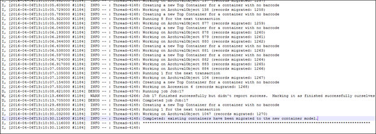
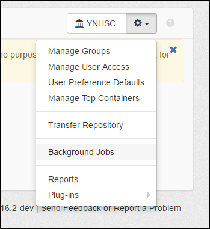
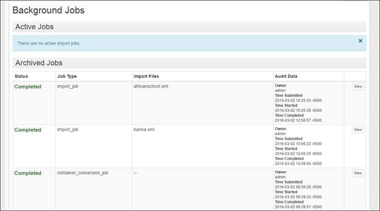
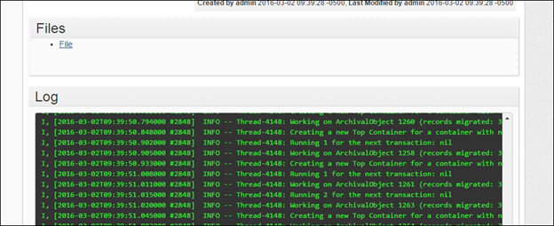
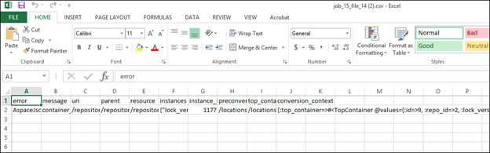

Aanvullende aandachtspunten voor de upgrade die specifiek zijn voor deze release en ook van toepassing zijn wanneer u een upgrade uitvoert van 1.4.2 of lager naar een versie tot en met 2.0.1. Raadpleeg de [upgradedocumentatie](/administration/upgrading) voor de standaardinstructies die in alle gevallen gelden.

## Algemeen overzicht

Voor de upgrade naar het nieuwe gegevensmodel in 1.5.0 is een aanzienlijke gegevensconversie nodig. Het is belangrijk dat u dit document doorneemt om inzicht te krijgen in de gevolgen en mogelijke neveneffecten.

De stappen in het kort:

1. Lees dit document en zorg dat u begrijpt welke gevolgen de upgrade voor uw gegevens heeft. Let daarbij vooral op het gedeelte [Voorbereiding](#preparation).
2. [Maak een back-up van uw database](/administration/backup).
3. Nee, echt: [maak een back-up van uw database](/administration/backup).
4. Het advies is om [een nieuwe Solr-index te maken](/administration/indexes). Verwijder hiervoor de map data/solr_index/index en alle bestanden in de map data/indexer_state. De ingebouwde versie van Solr is bijgewerkt; daardoor zou de index veel kleiner moeten worden.
5. Volg de standaard [upgrade-instructies](/administration/upgrading). Let op: het script setup-database.sh|bat wijzigt het databaseschema, maar verplaatst de gegevens niet. Als u de plug-in voor containerbeheer gebruikt, moet u deze uit de lijst met plug-ins in uw configuratiebestand verwijderen voordat u ArchivesSpace start.
6. Start ArchivesSpace. Wanneer 1.5.0 voor het eerst wordt gestart, begint een conversieproces dat de gegevens naar de nieuwe tabelstructuur verplaatst. **Tijdens dit proces is de applicatie niet beschikbaar.** De duur hangt af van de omvang van uw gegevens en de serverbronnen: van enkele minuten voor zeer kleine databases tot enkele uren voor zeer grote databases.
7. Zodra de conversie is voltooid, start de webapplicatie en bouwt het indexeerproces uw index opnieuw op. Afhankelijk van uw serveromgeving en de beschikbare bronnen kan de werking trager zijn terwijl het indexeerproces actief is.
8. Controleer de [uitvoer van het conversieproces](#conversion) aan de hand van de onderstaande instructies. Hoe lang het duurt voordat het rapport wordt geladen, hangt af van het aantal vermeldingen erin.

## Voorbereiding op en conversie naar de nieuwe functionaliteit voor containerbeheer

Met versie 1.5.0 introduceert ArchivesSpace een nieuw gegevensmodel waarmee u de containers waarin uw archiefmateriaal wordt bewaard uitgebreider en efficiënter kunt beheren. Om van deze verbeterde functionaliteit gebruik te maken:

- Collectiebeherende instellingen die ArchivesSpace al in productie gebruiken, moeten hun ArchivesSpace-applicatie upgraden naar versie 1.5.0. (Deze upgrade/conversie is ook nodig om gebruik te maken van andere nieuwe functies en bugfixes in ArchivesSpace 1.5.0 en latere versies.)
- Collectiebeherende instellingen die ArchivesSpace nog niet in productie gebruiken, maar wel gegevens uit Archivists’ Toolkit of Archon moeten migreren, moeten hun gegevens eerst migreren naar versie 1.4.2 van ArchivesSpace of een eerdere versie en die versie vervolgens upgraden naar versie 1.5.0. (Dit kan wanneer uw instelling klaar is om naar ArchivesSpace te migreren.)
- Collectiebeherende instellingen die ArchivesSpace nog niet in productie gebruiken en geen gegevens uit Archivists’ Toolkit of Archon hoeven te migreren, kunnen Archivists 1.5.0 gaan gebruiken zonder een upgrade uit te voeren. (In dat geval hoeft u niet verder te lezen.)

De conversie van het containermodel in versie 1.4.2 en eerdere versies van ArchivesSpace naar het model in versie 1.5.0 is complex en ondersteunt mogelijk niet alle manieren waarop verschillende instellingen containergegevens hebben vastgelegd. Daarom moet u bij een upgrade vanaf een versie vóór 1.5.0 de upgrade plannen, de resultaten controleren en gegevens mogelijk vóór of na de definitieve conversie corrigeren. Omdat containergegevens op veel verschillende manieren kunnen worden vastgelegd, is het onmogelijk om vooraf te weten welke gevolgen dit voor de gegevens van instellingen heeft. Daarom moeten **alle instellingen die hun ArchivesSpace upgraden naar versie 1.5.0 dit doen met een back-up van hun productieomgeving en in een testomgeving.** Een conversie kan alleen ongedaan worden gemaakt door terug te gaan naar de brondatabase.

## Veelgestelde vragen

_Hoe worden mijn gegevens naar het nieuwe model geconverteerd?_

Wanneer u uw installatie upgradet naar 1.5.0, vindt de conversie plaats als onderdeel van het upgradeproces.

_Kan ik het huidige containermodel blijven gebruiken en de gegevens niet naar het nieuwe model converteren?_

Vanwege de aanzienlijke verbeteringen (zie de [lijst met nieuwe functies](#new-features-in-150) hieronder) is het nieuwe model vereist voor iedereen die ArchivesSpace 1.5.0 of hoger gebruikt. De enige manier om het huidige model te blijven gebruiken, is om nooit verder te upgraden dan 1.4.2.

_Wat als ik de plug-in voor containerbeheer al gebruik die Yale University beschikbaar heeft gesteld aan de gemeenschap?_

Ook de conversie van gegevens die met de Yale-plug-in voor containerbeheer of een lokale aanpassing daarvan zijn aangemaakt, maakt deel uit van de upgrade naar 1.5.0. Stappen die niet nodig zijn, worden overgeslagen. Na afloop is het nieuwe containermodel in ArchivesSpace geïntegreerd en hoeft het niet als plug-in te worden geladen of onderhouden.

Wie de plug-in voor containerbeheer gebruikt, moet deze vóór het starten van de conversie uit de lijst in het configuratiebestand verwijderen. Anders treedt er een fout op met de validatienaam.

_Ik ben nog niet overgestapt van Archivists’ Toolkit of Archon en wil de bijbehorende migratietool gebruiken. Kan ik rechtstreeks naar 1.5.0 migreren?_

Nee. U moet eerst migreren naar versie 1.4.2 of een eerdere versie en vervolgens uw installatie upgraden naar 1.5.0 volgens de instructies in dit document.

_Welke wijzigingen worden aangebracht in het vorige containermodel?_

De belangrijkste wijziging is het nieuwe concept van topcontainers. Een topcontainer is de container van het hoogste niveau waarin een bepaalde instantie is opgeslagen. Topcontainers zijn in sommige opzichten vergelijkbaar met het huidige Container 1, maar zijn losgekoppeld van het volledige containerrecord (de onderliggende en grootoudercontainerrecords). Daardoor kunt u de containers van het hoogste niveau in uw collectie efficiënter registreren en bijwerken.

_Hoe bepaalt ArchivesSpace wat een topcontainer is?_

Tijdens de conversie zoekt ArchivesSpace alle Container 1-records in uw huidige ArchivesSpace-database op. Vervolgens worden deze als volgt beoordeeld:

- Als containers barcodes hebben, wordt voor elke unieke barcode van Container 1 één topcontainer aangemaakt.
- Als containers geen barcodes hebben, wordt binnen een collectie of nog niet ontsloten materiaal één topcontainer aangemaakt voor elke unieke combinatie van de indicator van Container 1 en het containertype van Container 1.
- Nadat een topcontainer is aangemaakt, worden extra instantierecords voor dezelfde container binnen een nog niet ontsloten materiaal of collectie aan dat topcontainerrecord gekoppeld.

## Voorbereiding

_Wat kan ik doen om mijn ArchivesSpace-gegevens voor te bereiden op een soepelere conversie naar topcontainers?_

- Als uw Container 1-records unieke barcodes hebben, hoeft u niets te doen behalve controleren of uw gegevens volledig en correct zijn. Voer een voorlopige conversie uit zoals beschreven in het gedeelte Conversie en los eventuele fouten op.
- Als uw Container 1-records geen barcodes hebben, maar binnen elk nog niet ontsloten materiaal of elke collectie een unieke reeks containeridentificaties hebben (bijvoorbeeld Doos 1, Doos 2, Doos 3), of als identificaties binnen een nog niet ontsloten materiaal of een collectie alleen opnieuw worden gebruikt voor verschillende containertypen (bijvoorbeeld Doos 1 tot en met 10 en Formaatdoos 1 tot en met 3), hoeft u niets te doen behalve controleren of uw gegevens volledig en correct zijn. Voer een voorlopige conversie uit zoals beschreven in het gedeelte Conversie en los eventuele fouten op.
- Als uw Container 1-records geen barcodes hebben en u parallelle nummerreeksen gebruikt, waarbij dezelfde indicatoren en typen binnen sommige of alle nog niet ontsloten materialen of collecties naar verschillende containers verwijzen (bijvoorbeeld een Doos 1 in serie 1 en een andere Doos 1 in serie 5), moet u deze containers op een manier uniek identificeren. U kunt hiervoor de [barcoder-plug-in](https://github.com/archivesspace-plugins/barcoder) uitvoeren voor elke collectie waarop dit van toepassing is. De barcoder-plug-in maakt barcodes aan waarin de ID van het bovenliggende archiefonderdeel op het hoogste niveau wordt gecombineerd met het type en de indicator van Container 1. (De barcoder-plug-in is ontworpen om op één collectie tegelijk te worden uitgevoerd, niet op alle collecties, omdat niet alle collecties in een instelling aan deze voorwaarde hoeven te voldoen.) Nadat u de containers met parallelle nummerreeksen van elkaar hebt onderscheiden, voert u een voorlopige conversie uit zoals beschreven in het gedeelte Conversie en lost u eventuele fouten op.

U hoeft geen wijzigingen aan te brengen in de velden Container 2 of Container 3. De gegevens in deze velden worden geconverteerd naar de nieuwe velden Subcontainer en Sub-subcontainer, die rechtstreeks aan deze velden zijn gekoppeld.

Als u de huidige velden voor containeromvang gebruikt, zijn deze niet meer beschikbaar in 1.5.0. Gegevens in deze velden worden tijdens de conversie gemigreerd naar een nieuw subrecord voor omvang. Na de conversie kunt u beoordelen of deze gegevens in een omvangrecord moeten blijven staan of beter in een containerprofiel of andere velden thuishoren, en ze vervolgens verplaatsen.

_Ik heb nog EAD's die ik in ArchivesSpace moet importeren. Hoe kan ik ze voorbereiden op dit nieuwe model?_

Als een onderdeel een doos en een map bevat (of als containers op een andere manier hiërarchisch zijn gerelateerd), moet u identificaties aan het containerelement toevoegen, zodat de EAD-importeur weet welke container de topcontainer is. Als u eerder Archivists' Toolkit hebt gebruikt om EAD aan te maken, bevatten uw containers waarschijnlijk al containeridentificaties. Als uw containerelementen nog geen identificaties hebben, heeft Yale University een [XSLT-transformatiebestand](https://github.com/YaleArchivesSpace/xslt-files/blob/master/EAD_add_IDs_to_containers.xsl) beschikbaar gesteld om deze toe te voegen. Voer dit bestand uit voordat u het EAD-bestand in ArchivesSpace importeert.

## Conversie

Bij een upgrade van versie 1.4.2 (of een eerdere versie) naar 1.5.0 vindt de containerconversie plaats als onderdeel van het upgradeproces. U kunt de voortgang ervan in het logboek volgen. Instructies voor het upgraden vanaf een eerdere versie van ArchivesSpace staan in de [upgradedocumentatie](/administration/upgrading).

Omdat dit een grote wijziging in het gegevensmodel van dit deel van de applicatie is, wordt sterk aangeraden om ten minste één testconversie uit te voeren. Volg deze stappen om het upgrade-/conversieproces uit te voeren:

- Maak een back-up van uw ArchivesSpace-instantie voor gebruik bij het testen. **VOER DIT NIET UIT OP EEN PRODUCTIE-INSTANTIE. DE CONVERSIE WIJZIGT UW GEGEVENS EN DE WIJZIGINGEN KUNNEN ALLEEN ONGEDAAN WORDEN GEMAAKT DOOR TERUG TE GAAN NAAR EEN BACK-UP VAN UW GEGEVENS VAN VÓÓR DE CONVERSIE.**
- Volg de upgrade-instructies om een nieuwe kopie van versie 1.5.0 uit te pakken voor het testen, uw configuratie- en gegevensbestanden te kopiëren en uw locales over te zetten.
- **Het advies is om uw Solr-indexbestanden te verwijderen en met een lege index te beginnen.** De versie van Solr die bij de applicatie wordt geleverd, wordt bijgewerkt en voor de upgrade moeten alle ArchivesSpace-gegevens opnieuw worden geïndexeerd. Verwijder hiervoor de map data/solr_index/index en de bestanden in data/indexer_state.
- Volg de upgrade-instructies om de databasemigraties uit te voeren. Tijdens deze stap worden uw containergegevens naar het nieuwe gegevensmodel geconverteerd. U kunt de voortgang in het logboek volgen. Windows-gebruikers kunnen het bestand archivesspace.out openen met een programma zoals Notepad ++. Mac-gebruikers kunnen tail –f logs/archivesspace.out uitvoeren om het logboek live te volgen.
- Na afloop van de testconversie vermeldt het logboek: "Completed: existing containers have been migrated to the new container model."

- Open ArchivesSpace in uw browser en meld u aan.
  Haal het foutenrapport van de containerconversie op in het gedeelte Achtergrondtaken:
- Selecteer Achtergrondtaken in het menu Instellingen.

- Het eerste item onder Gearchiveerde taken na de upgrade moet container_conversion_job zijn. Klik op Weergeven.

- Klik onder Bestanden op Bestand om een CSV-bestand met de fouten en een korte toelichting te downloaden.

- Ga terug naar uw brongegevens en corrigeer eventuele fouten voordat u opnieuw een testconversie uitvoert.
- Wanneer het foutenrapport geen fouten meer bevat, of wanneer u tevreden bent met de resterende fouten, is uw productie-instantie klaar voor de upgrade.
- Nadat de definitieve upgrade/conversie is voltooid, kunt u ArchivesSpace versie 1.5.0 in productie nemen.

_Welke veelvoorkomende fouten of afwijkingen worden tijdens de conversie gemeld?_

- Een container met een barcode heeft in verschillende records verschillende indicatoren of typen.
- Een container met een bepaald type en een bepaalde indicator heeft soms wel en soms geen barcode.
- Bij een container ontbreekt een type of indicator.
- Er zijn containerniveaus overgeslagen (bijvoorbeeld: er is een Container 1 en een Container 3, maar geen Container 2).
- Een container heeft meerdere locaties.

Het conversieproces kan sommige van deze fouten oplossen door waarden toe te voegen of te verwijderen, al naargelang wat passend lijkt. Voor de meeste controle over het proces kunt u deze problemen waarschijnlijk het beste zelf in uw ArchivesSpace-database oplossen voordat u naar het nieuwe containermodel converteert.

_Zijn er bekende conversieproblemen?_

Door een wijziging in de EAD-importeur van ArchivesSpace in 2015 werden sommige EAD-bestanden met hiërarchische containers die niet met een @parent-attribuut waren aangeduid, omgezet in meerdere instantierecords. Dit is inmiddels in de applicatie gecorrigeerd, maar we werken aan een plug-in (nu beschikbaar als [Instance Joiner Plugin](https://github.com/archivesspace-plugins/instance_joiner) waarmee u deze weer kunt omzetten naar afzonderlijke instanties, zodat subcontainers niet per ongeluk als topcontainers worden behandeld.

## Nieuwe functies in 1.5.0

**Topcontainers vervangen Container 1-records.** In tegenstelling tot Container 1-records in de huidige versie van ArchivesSpace kunnen topcontainers in de nieuwe versie één keer worden gedefinieerd en herhaaldelijk worden gekoppeld aan verschillende archiefonderdelen, collecties en records van nog niet ontsloten materiaal.

**De mogelijkheid om containerprofielen aan te maken en aan topcontainers te koppelen.** Met optionele containerprofielen kunt u gegevens over de containers zelf vastleggen, waaronder de afmetingen.

**Omvangcalculator.** Met de nieuwe omvangcalculator kunt u in combinatie met containerprofielen eenvoudig de omvang bekijken van records voor nog niet ontsloten materiaal, collecties of collectieonderdelen. U kunt de calculator ook gebruiken om omvangrecords aan te maken voor een record van nog niet ontsloten materiaal, een collectie of een collectieonderdeel.

**Bulkbewerkingen voor containers.** Het gedeelte Topcontainers beheren biedt efficiëntere manieren om met meerdere containers te werken, zoals barcodes toevoegen of bewerken, locaties wijzigen en topcontainers in bulk verwijderen.

**De mogelijkheid om dozen op een betekenisvolle manier tussen collecties te delen.** U kunt topcontainers los van individuele records van nog niet ontsloten materiaal en collecties definiëren en ze vanuit meerdere records van nog niet ontsloten materiaal en collecties openen. Dit kan bijvoorbeeld handig zijn om gegevens vast te leggen over een formaatdoos met materiaal uit meerdere collecties.

**De mogelijkheid om gegevens op te slaan waarmee u ArchivesSpace kunt synchroniseren met itemrecords in uw ILS.** Als uw instelling in haar ILS itemrecords voor containers aanmaakt, kunt u die gegevens nu ook in ArchivesSpace vastleggen.

**De mogelijkheid om gegevens op te slaan over de beperkingen op materiaal in een container.** U kunt nu in één oogopslag zien of er beperkingen gelden voor een deel van de inhoud van een container.

**Machinaal toepasbare beperkingen.** U kunt voortaan begin- en einddatums koppelen aan de notities "voorwaarden voor toegang" en "voorwaarden voor gebruik". U kunt ook een lokaal beperkingstype koppelen aan beperkingen zonder tijdsduur. Zo kunt u beperkingen die verlopen beter beheren en opnieuw beschrijven.

Raadpleeg voor meer informatie over het gebruik van de nieuwe functies de gebruikershandleiding, met name het nieuwe gedeelte met de titel Containers beheren (beschikbaar vanaf eind april 2016).
