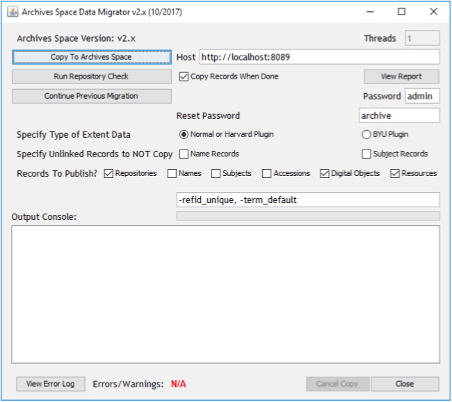

Deze richtlijnen beschrijven hoe u gegevens migreert uit Archivists' Toolkit 2.0 Update 16 naar alle ArchivesSpace 2.1.x- of 2.2.x-uitgaven met behulp van de migratietool van ArchivesSpace. Deze richtlijnen en migratietool ondersteunen geen migraties van eerdere versies van Archivists' Toolkit (AT) of andere versies van ArchivesSpace.

> Opmerking: Voer een migratie van Archivists' Toolkit naar ArchivesSpace niet uit op een actieve productiedatabase.

## Migratie voorbereiden

- Maak een kopie van de AT-instantie, inclusief de database, die u wilt migreren en gebruik die als bron voor de migratie. Het wordt sterk aanbevolen om uw AT-productie-instantie en -database niet als bron voor de migratie te gebruiken, zodat u de productieversie beschermt tegen eventuele afwijkingen die tijdens het migratieproces kunnen optreden.
- Controleer de kwaliteit van de gegevens in de brondatabase. Zoek naar ongeldige records, dubbele naam- en onderwerprecords en dubbele gecontroleerde waarden. Onregelmatige gegevens worden overgenomen in de ArchivesSpace-instantie of kunnen in sommige gevallen het migratieproces blokkeren.
- Selecteer een representatieve steekproef van records voor nog niet ontsloten materiaal, collecties en digitale objecten om na afloop van de migratie grondig te onderzoeken. Zorg ervoor dat de steekproef zowel de eenvoudigste als de meest ingewikkelde of uitgebreide records uit de gehele gegevensverzameling bevat.

### Opmerkingen

- Een AT-onderwerprecord krijgt het type 'topical' als het geen geldige AT-typeaanduiding heeft of als het type niet voorkomt tussen de typen in ArchivesSpace. Verschillende andere AT LookupList-waarden zijn niet beschikbaar in ArchivesSpace. Deze LookupList-waarden kunnen niet tijdens de AT-migratie worden toegevoegd en moeten daarom vóór de migratie in AT worden gewijzigd. Raadpleeg de datamap voor alle details over de toewijzingen van enumeraties (lijsten met gecontroleerde waarden). U kunt de AT Lookup List-tool gebruiken om waarden te wijzigen die volgens de datamap niet correct worden toegewezen.
- Auditgegevens van records (aangemaakt door, aanmaakdatum, gewijzigd door en wijzigingsdatum) worden niet van AT naar ArchivesSpace gemigreerd. ArchivesSpace kent nieuwe auditgegevens toe aan elk record wanneer het wordt geïmporteerd. De uitzondering hierop is de gebruikersnaam van de gebruiker die een record voor nog niet ontsloten materiaal aanmaakt; deze wordt gemigreerd naar het algemene notitieveld voor dat materiaal.
- Implementeer een productieversie van ArchivesSpace, inclusief de configuratie van een MySQL-database waarnaar u kunt migreren. Instructies vindt u in [Aan de slag met ArchivesSpace](/administration/getting_started) en [ArchivesSpace gebruiken met MySQL](/provisioning/mysql).

## AT-gegevens voorbereiden op migratie

- Het migratieproces verloopt iteratief. Aan het einde van elke migratieronde wordt een migratierapport gegenereerd. Het rapport bevat fouten en problemen die tijdens de migratie zijn opgetreden. (Aan het einde van dit document vindt u een voorbeeld van een AT-migratierapport.) Gebruik dit rapport om te bepalen of problemen in de migratieresultaten het best kunnen worden opgelost in de brongegevens of in de gemigreerde gegevens in de ArchivesSpace-instantie. Als u de problemen in de brongegevens oplost, kunt u de migratie eenvoudig opnieuw uitvoeren.
- Nadat u de migratie hebt geaccepteerd en problemen in de gemigreerde gegevens hebt opgelost, kunt u de brongegevens niet opnieuw migreren zonder een nieuwe doelinstantie van ArchivesSpace in te stellen. Migratie naar een ArchivesSpace-database waarnaar al eerder is gemigreerd, kan veel foutmeldingen over dubbele records opleveren en onherstelbare schade aan de ArchivesSpace-database veroorzaken.
- Houd er rekening mee dat gegevensmigratie veel geheugen en tijd kan vergen, omdat er een groot aantal records wordt overgezet. Daarom raden we aan de AT-migratie uit te voeren op een computer met ten minste 2 GB beschikbaar geheugen.
- Zorg ervoor dat uw ArchivesSpace MySQL-database correct is ingesteld volgens de documentatie in het README-bestand van ArchivesSpace. Bij het aanmaken van een MySQL-database MOET u de standaardtekencodering van de database instellen op UTF8. Dit is vooral belangrijk als u een MySQL-client zoals Navicat, MySQL Workbench of phpMyAdmin gebruikt om de database aan te maken. Zie [ArchivesSpace gebruiken met MySQL](/provisioning/mysql) voor meer informatie.
- Verhoog de maximale Java-heapruimte als er time-outs optreden. Doe dit als volgt:
  - Stop de huidige ArchivesSpace-instantie.
  - Open het bestand "archivesspace.sh" (Linux / Mac OSX) of archivesspace.bat (Windows) in een teksteditor. Het bestand staat in de installatiemap van ArchivesSpace.
  - Zoek de tekenreeks "-Xmx512m" en wijzig deze in "-Xmx1024m".
  - Sla het bestand op.
  - Start de ArchivesSpace-instantie opnieuw.
  - Start het AT-migratieproces opnieuw.

## De migratietool uitvoeren als AT-plug-in

- Zorg ervoor dat de AT-instantie waaruit u wilt migreren is afgesloten. Download vervolgens het bestand "scriptAT.zip" van de uitgavepagina voor at-migration (https://github.com/archivesspace/at-migration/releases) en kopieer het bestand naar de map plugins van de AT-instantie. Overschrijf het bestaande bestand indien nodig.
- Zorg ervoor dat de ArchivesSpace-instantie waarnaar u migreert actief is.
- Start de AT-instantie opnieuw om de nieuw geïnstalleerde plug-in te laden. Open het menu "Hulpmiddelen" om de plug-in uit te voeren, selecteer vervolgens "Script Runtime v1.0" en ten slotte "ArchivesSpace Data Migrator". Het venster van de plug-in wordt dan weergegeven.

- Wijzig de standaardgegevens in de gebruikersinterface van de migratietool:
  - **Threads** – Hiermee geeft u het aantal clients op dat wordt gebruikt om records voor collecties gelijktijdig te kopiëren. Het maximumaantal clients hangt af van de recordgrootte en het toegewezen geheugen. Een aantal van 4 tot 6 is doorgaans een goede keuze, maar u kunt dit verlagen als er een "Out of Memory Exception" optreedt.
  - **Host** – De URL en het poortnummer van de ArchivesSpace-backendserver.
  - **Selectievakje "Copy records when done"** – Hiermee geeft u aan dat de records moeten worden gekopieerd zodra de controle van de collectiebeherende instelling is voltooid.
  - **Password** – Het wachtwoord voor het ArchivesSpace-account "admin". De standaardwaarde "admin" zou moeten werken, tenzij deze door de ArchivesSpace-beheerder is gewijzigd.
  - **Reset Password** – Het wachtwoord van elke overgezette gebruikersaccount wordt hiermee opnieuw ingesteld. Gebruikers moeten hun wachtwoord wijzigen wanneer ze zich voor het eerst aanmelden, tenzij LDAP wordt gebruikt voor authenticatie.
  - **Keuzerondje "Specify Type of Extent Data"** – Selecteer deze optie als u de BYU-plug-in gebruikt. Laat anders de standaardinstelling staan: Normal of Harvard Plugin.
  - **Selectievakjes "Specify Unlinked Records to NOT Copy"** – Als u naam- of onderwerprecords hebt die niet zijn gekoppeld aan records voor nog niet ontsloten materiaal, collecties of digitale objecten, kunt u ervoor kiezen deze niet naar ArchivesSpace te migreren.
  - **Selectievakjes "Records to Publish?"** – Hiermee geeft u aan welke typen records na de migratie naar ArchivesSpace moeten worden gepubliceerd.
  - **Tekstvak met -refid_unique, -term_default** – Dit is nodig om de migratietool te laten werken. Breng geen wijzigingen aan in dit gedeelte.
  - **Output Console** – Gedeelte waarin u de migratie kunt volgen terwijl deze wordt uitgevoerd.
  - **View Error Log** – Hiermee kunt u een overzicht bekijken van alle fouten die tijdens het migratieproces zijn opgetreden. U kunt dit ook bekijken terwijl het migratieproces nog bezig is.
- Nadat u de gewenste wijzigingen in de gebruikersinterface hebt aangebracht, kunt u het migratieproces starten met een van de drie knoppen.
  - **Copy to ArchivesSpace** – Hiermee start u de migratie naar de ArchivesSpace-instantie die wordt aangegeven door de Host-URL en waarvoor u de gewenste wijzigingen in de gebruikersinterface hebt aangebracht. Er zijn drie knoppen om het migratieproces te starten.
  - **Run Repository Check** – De controle van de collectiebeherende instelling zoekt naar onjuiste koppelingen tussen collecties en gekoppelde records voor nog niet ontsloten materiaal of digitale objecten, en probeert deze te herstellen. De herstelactie kopieert het gekoppelde record voor nog niet ontsloten materiaal of digitale object naar de collectiebeherende instelling van het collectierecord in de ArchivesSpace-database (de posities van die records worden niet gewijzigd in de AT-database).

    De herstelactie is geldig zolang records voor nog niet ontsloten materiaal niet aan meerdere collectierecords in verschillende collectiebeherende instellingen zijn gekoppeld. Anders ontvangt u een waarschuwing. In dat geval worden de records voor de collectie en het nog niet ontsloten materiaal wel gemigreerd, maar niet aan elkaar gekoppeld. U moet die koppelingen in ArchivesSpace opnieuw aanbrengen.

    Dit probleem met onjuiste koppelingen betreft alleen records voor nog niet ontsloten materiaal en collecties, niet records voor digitale objecten, omdat records voor nog niet ontsloten materiaal en collecties een veel-op-veelrelatie hebben. Beoordelingen kunnen ook een veel-op-veelrelatie hebben met collecties, records voor nog niet ontsloten materiaal en digitale objecten. Omdat beoordelingen echter klein en snel te kopiëren zijn, worden ze gewoon naar zoveel mogelijk collectiebeherende instellingen gekopieerd om alle juiste koppelingen tot stand te brengen.

    Als het selectievakje "Copy Records When Done" is ingeschakeld, worden de records na afloop van de controle naar de ArchivesSpace-instantie gemigreerd.

  - **Continue Previous Migration** – Als het migratieproces mislukt, kunt u hiermee verdergaan vanaf het punt waar de vorige mislukte migratie is gestopt. Hierdoor zou het migratieproces voor collectierecords op een gecontroleerde manier opnieuw moeten kunnen worden gestart, zonder dat u de ArchivesSpace-backenddatabase hoeft op te schonen en helemaal opnieuw hoeft te beginnen.

- Het gegevensmigratieproces verloopt grotendeels automatisch en genereert na afloop een foutenlogboek. Afhankelijk van de gegevens kunnen er echter verschillende fouten optreden. Nadat u deze hebt opgelost, moet u de migratie mogelijk opnieuw uitvoeren. De duur van een migratie hangt af van verschillende factoren (zoals de databasegrootte en netwerkprestaties) en kan variëren van enkele uren tot enkele dagen.
- De gegevens van de volgende AT-modules worden gemigreerd:
  - Opzoeklijsten
  - Collectiebeherende instellingen
  - Locaties
  - Gebruikers
  - Onderwerpen
  - Namen
  - Records voor nog niet ontsloten materiaal
  - Digitale objecten en componenten van digitale objecten
  - Collecties en collectieonderdelen
  - Beoordelingen
- Gegevens
  - Rapporten uit de volgende AT-modules worden niet gemigreerd
    > INFORMATIE ONTBREEKT IN HET BRONDOCUMENT - MOET WORDEN GECONTROLEERD!!!

## De migratie beoordelen en gegevens opschonen

Gebruik het migratierapport om de getrouwheid van de migratie te beoordelen en te bepalen of u:

- gegevens in de AT-broninstantie wilt corrigeren en de migratie opnieuw wilt uitvoeren, of
- gegevens in de ArchivesSpace-doelinstantie wilt corrigeren.

Als u ervoor kiest de gegevens in AT te corrigeren en de migratie opnieuw uit te voeren, moet u alle inhoud in de ArchivesSpace-instantie verwijderen.

Als u de migratie in de ArchivesSpace-instantie accepteert, kunt u uw gegevens als volgt controleren en corrigeren.

- Stel gebruikerswachtwoorden opnieuw in. Gebruikersrecords worden wel gemigreerd, maar de bijbehorende wachtwoorden niet. U moet de wachtwoorden opnieuw toewijzen volgens het beleid of de conventies van uw collectiebeherende instellingen.
- Controleer de steekproef van records die u hebt geselecteerd zorgvuldig:
  - Records voor nog niet ontsloten materiaal
  - Collecties
  - Digitale objecten
- Controleer de volgende groepen records en verifieer of het juiste aantal records is gemigreerd:
  - Records voor nog niet ontsloten materiaal
  - Beoordelingen
  - Collecties
  - Digitale objecten
  - Lijsten met gecontroleerde waarden
  - Onderwerpen
  - Agenten (naamrecords in AT)
  - Locaties
  - Classificaties voor collectiebeheer
  - Er kunnen enkele extra agentrecords zijn vanwege standaardinstellingen van ArchivesSpace, of extra beoordelingsrecords als deze waren gekoppeld aan records van meer dan één collectiebeherende instelling.
- Let tijdens de controles op dubbele of onvolledige records, verbroken koppelingen en afgekorte gegevens.
- Controleer de containergegevens en locaties extra zorgvuldig. Het model hiervoor verschilt aanzienlijk tussen AT en ArchivesSpace (waar locaties aan een container zijn gekoppeld in plaats van rechtstreeks aan een collectie of record voor nog niet ontsloten materiaal), wat de migratie ingewikkelder maakt.
- Voeg enumeratiewaarden zo nodig samen. Als u bijvoorbeeld zowel 'local' als 'local sources' als bron voor namen hebt, kan het verstandig zijn deze waarden samen te voegen.
