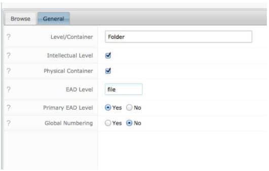
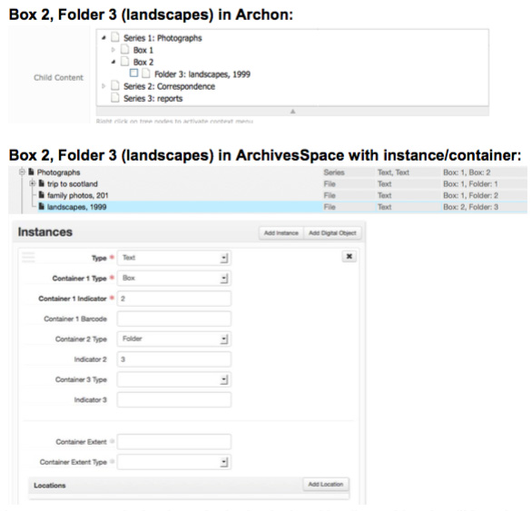
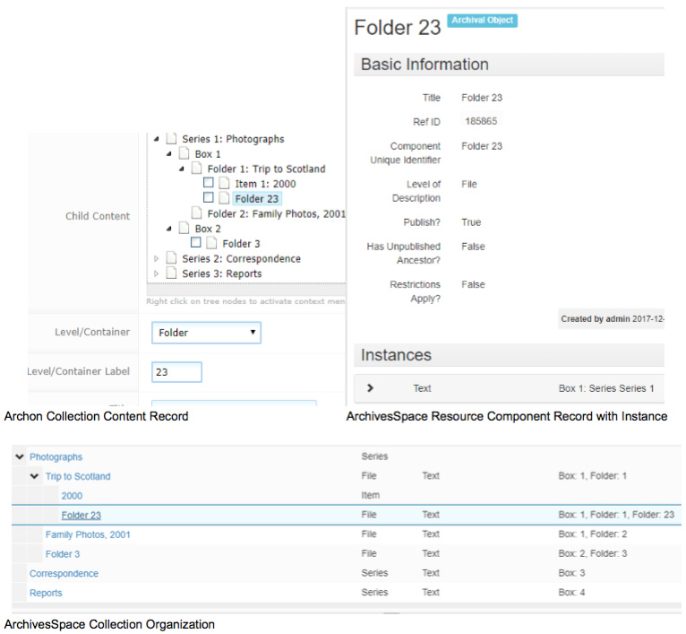
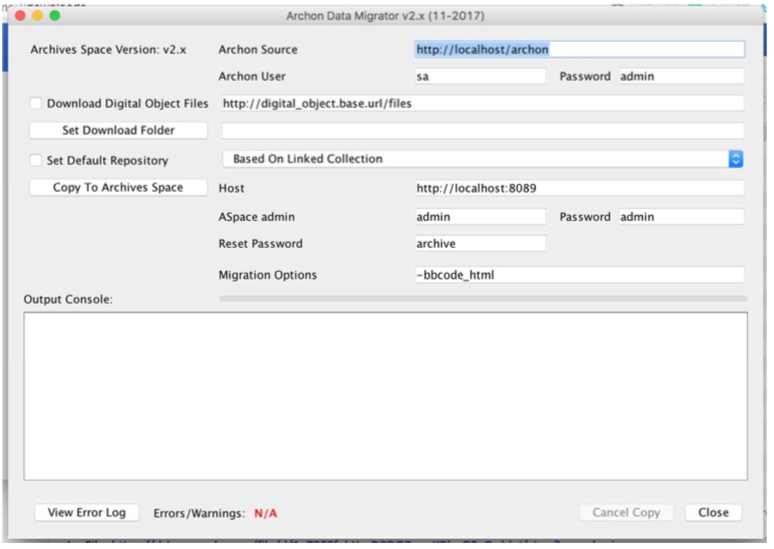

Deze richtlijnen beschrijven het migreren van gegevens van Archon 3.21-rev3 naar ArchivesSpace 2.2.2 met de migratietool van ArchivesSpace. Deze richtlijnen en migratietool ondersteunen geen migraties van gegevens uit eerdere versies van Archon of andere versies van ArchivesSpace.

> Opmerking: Voer een migratie van Archon naar ArchivesSpace niet uit op een actieve productiedatabase.

## Voorbereiding van de migratie

Selecteer een representatieve steekproef van records over nog niet ontsloten materiaal, classificaties, collecties, collectie-inhoud en digitale objecten om na afloop van de migratie zorgvuldig te onderzoeken. Zorg ervoor dat de steekproef zowel eenvoudige als ingewikkeldere of uitgebreidere records bevat.

Controleer de gegevenskwaliteit van uw Archon-database

### Records over nog niet ontsloten materiaal

- Geef indien mogelijk voor alle records een datum van binnenkomst op. Als in Archon geen datum van binnenkomst is vastgelegd, wordt tijdens de migratie de datum 01/01/9999 ingevuld. Als u deze standaardwaarde wilt wijzigen, kunt u vóór de migratie het volgende bestand in de nieuwe Archon-distributie bewerken:
  `packages/core/templates/default/accession-list.inc.php`
- Geef indien mogelijk voor alle records een identificatiecode op. Als in Archon geen identificatiecode is vastgelegd, wordt tijdens de migratie een identificatiecode samengesteld op basis van de datum en de afgekorte titel van het record.

### Classificatierecords

Zorg ervoor dat er op hetzelfde niveau in de classificatiehiërarchie geen dubbele classificatietitels voorkomen. Als de migratietool een dubbele waarde tegenkomt, mislukken mogelijk enkele opslagbewerkingen voor classificaties en moet u de migratie opnieuw uitvoeren.

### Collectierecords

Als genormaliseerde datums niet correct zijn vastgelegd (bijvoorbeeld als de einddatum en begindatum zijn omgewisseld), worden ze niet gemigreerd of kan de migratie mislukken. Een systeembeheerder kan de volgende query op de database uitvoeren om zulke vermeldingen te vinden:

`SELECT ID, Title, NormalDateBegin, NormalDateEnd FROM tblCollections_Collections WHERE NormalDateBegin > NormalDateEnd;`

### Niveau-/containermanager

Controleer de instellingen en zorg ervoor dat voor elke 'niveaucontainer' de juiste waarden zijn ingesteld bij 'Intellectueel niveau' en 'Fysieke container' en dat de EAD-waarden correct zijn vastgelegd.

Als de waarden van niveaucontainers niet correct zijn gecodeerd, kunnen archiefonderdelen in ArchivesSpace verkeerd worden genest. U hoeft de volgende informatie niet vóór de migratie te verwerken, maar houd er rekening mee als de inhoud na de migratie niet correct is genest:

- Records met collectie-inhoud waarvan de niveaucontainer is ingesteld op 'Alleen intellectueel' worden als archiefonderdelen naar ArchivesSpace gemigreerd. Voor elk niveau/container waarvoor 'intellectueel niveau' is aangevinkt, moet in het veld 'EAD-niveau' een geldige waarde zijn vastgelegd (bijvoorbeeld class, collection, file, fonds, item, otherlevel, recordgrp, series, subfonds, subgrp, subseries). Deze waarden zijn hoofdlettergevoelig. Alle andere waarden worden voor de betreffende records met collectie-inhoud/archiefonderdelen gemigreerd als "otherlevel".
- Records met collectie-inhoud waarvan de niveaucontainer is ingesteld op 'Alleen fysiek' worden gemigreerd als instantierecords van het type 'text', gekoppeld aan een container in ArchivesSpace. Deze instantie-/containerrecords worden gekoppeld aan het intellectuele niveau of de intellectuele niveaus die in Archon eerder als directe onderliggende niveaus van de container waren vastgelegd. Als de instantie/container geen onderliggende niveaus heeft, wordt deze gekoppeld aan het bovenliggende intellectuele niveau. Ter illustratie tonen de volgende schermafbeeldingen een containerrecord vóór en na de migratie.
  
- Records met collectie-inhoud die zowel fysieke als intellectuele niveaus hebben, worden zowel als archiefonderdelen als instanties gemigreerd. In dat geval wordt de instantie aan het archiefonderdeel gekoppeld.
- Records met collectie-inhoud die geen fysiek of intellectueel niveau hebben, worden behandeld alsof ze zijn ingesteld op 'Alleen intellectueel'. Dit wordt afgeraden en moet vóór de migratie worden hersteld.

### Records met collectie-inhoud

- Als in Archon geen waarde is ingesteld voor het veld 'Titel' of 'Inclusieve datums' van een 'intellectueel' niveau/container, krijgt het te migreren record met collectie-inhoud een titel op basis van de waarde van 'label' en het in Archon ingestelde type 'niveau/container'.
  
- Controleer eventueel, als een migratie mislukt, of records met collectie-inhoud verwijzen naar ongeldige 'niveaus/containers'. Deze records staan in de databasetabellen, maar zijn niet zichtbaar voor medewerkers of eindgebruikers en moeten vóór de migratie worden verwijderd. Als ze niet worden verwijderd, mislukt de migratie. Volg deze stappen om deze records te identificeren. **Wees zeer voorzichtig. Maak eerst een back-up van de database of raadpleeg een systeembeheerder als u niet zeker weet wat u doet!**
- Open in MySQL of SQL Server de tabel 'tblCollections_LevelContainers'. Noteer de 'ID'-waarde van elke rij (d.w.z. LevelContainer).
- Voer een query uit op tblCollections_Content om records te vinden waarvan de kolom LevelID naar een ongeldige waarde verwijst. Als tblCollections_Level Containers bijvoorbeeld 'ID'-waarden 1-6 en 8-22 bevat:
  `SELECT * FROM tblCollections_Content WHERE LevelContainerID > 22 OR (LevelContainerID > 6 AND LevelContainerID < 8);`
  Hiermee wordt een lijst weergegeven van alle records met een ongeldige 'LevelID' (d.w.z. records waarvoor de primaire sleutel waarnaar een vreemde sleutel verwijst niet kan worden gevonden). Controleer deze lijst zorgvuldig en bepaal of u de records wilt verwijderen, of wijzig de LevelID in een geldig geheel getal als u de records wilt behouden. Als u de records verwijdert, moet u dit rechtstreeks in de database doen (zie hieronder). Als u de records wilt behouden, moet u mogelijk aanvullende stappen rechtstreeks in de database uitvoeren om deze records aan een geldig bovenliggend inhoudsrecord of een geldige collectie te koppelen; aanvullende instructies zijn op verzoek beschikbaar.
- Voer een query uit om de ongeldige records uit de tabel met collectie-inhoud te verwijderen. Bijvoorbeeld:
  `DELETE FROM tblCollections_Content WHERE LevelContainerID > 22 OR (LevelContainerID > 6 AND LevelContainerID < 8);`
- Controleer eventueel, als de migratie mislukt, of er 'dubbele' records met collectie-inhoud zijn. 'Dubbele' records bevinden zich op hetzelfde knooppunt in de hiërarchie van collectie-inhoud. Voer de volgende query uit in mysql of sql server om zulke records te controleren.
  `SELECT ParentID, SortOrder, COUNT (*) FROM tblCollections_Content GROUP BY ParentID, SortOrder HAVING COUNT(*) > 1;`
- De bovenstaande query controleert op records die zich op dezelfde vertakking en dezelfde positie in de inhoudshiërarchie bevinden. Als u zulke records vindt, moet u de sorteerwaarde van een van de records wijzigen, zodat beide records een unieke positie innemen. Voer hiervoor een query uit om alle records te vinden die aan het bovenliggende record zijn gekoppeld en voer daarna een updatequery uit om de sorteerwaarde van een van de betreffende records te wijzigen, zodat elk record een unieke sorteerwaarde heeft. Als de bovenstaande query bijvoorbeeld een 'dubbele' ParentID-waarde oplevert, voert u query één uit met de betreffende ParentID-waarde om de records te identificeren en query twee om het probleem op te lossen:
  **Query één:**

  `SELECT ID, ParentID, SortOrder, Title FROM tblCollections_Content WHERE ParentID=8619;`

  | ID   | ParentID | SortOrder | Title       |
  | ---- | -------- | --------- | ----------- |
  | 8620 | 8619     | 1         | naar moeder |
  | 8621 | 8619     | 1         | van moeder  |
  | 8622 | 8619     | 3         | naar vader  |
  | 6823 | 8619     | 4         | van vader   |

  **Query twee:**

  `UPDATE tblCollections_Content SET SortOrder=2 WHERE ID=8621;`

## Voorbereiding voor de migratie van Archon-gegevens

Het migratieproces verloopt iteratief. Plan meerdere testmigraties en sluit af met een definitieve migratie. Voor de migratie is doorgaans hulp van een systeembeheerder nodig.

De migratietool maakt verbinding met uw Archon-installatie, leest gegevens van gedefinieerde 'eindpunten' en plaatst de informatie in een doelinstantie van ArchivesSpace.

Na elke migratieronde wordt een migratierapport gegenereerd dat u vanuit de applicatie kunt downloaden. Het rapport vermeldt fouten en problemen die tijdens de migratie zijn opgetreden. Voorbeeldgegevens uit een migratierapport staan in [Bijlage A](#Appendix-A%3A-Migration-Log-Review).

Gebruik dit rapport om te bepalen of problemen in de migratieresultaten het best kunnen worden opgelost in de brongegevens of in de gemigreerde gegevens in de ArchivesSpace-instantie. Als u de problemen in de brongegevens oplost, kunt u de database leegmaken en de migratie opnieuw uitvoeren. Zodra u de migratie echter accepteert en de gemigreerde gegevens in ArchivesSpace wijzigt, kunt u de brongegevens niet opnieuw migreren zonder de vorige migratie te overschrijven of een nieuwe doelinstantie van ArchivesSpace in te stellen.

Houd er rekening mee dat gegevensmigratie veel geheugen en tijd kan kosten vanwege de grote hoeveelheid records die wordt overgezet. Daarom raden we aan de Archon-migratietool uit te voeren op een server met ten minste 2 GB beschikbaar geheugen. Testmigraties duurden minder dan een uur, maar bij complexe en grote Archon-instanties ook twaalf uur of langer.

Controleer vóór de migratie of uw huidige Archon-installatie up-to-date is: u moet versie 3.21 rev3 gebruiken. Als u een eerdere versie van Archon gebruikt, maakt u een kopie van de Archon-instantie die moet worden gemigreerd, inclusief de database, en gebruikt u die als migratiebron. We raden ten zeerste af om uw productie-instantie van Archon en de bijbehorende database als migratiebron te gebruiken, om de productieversie te beschermen tegen eventuele afwijkingen tijdens het migratieproces. Werk de kopie van de Archon-instantie bij naar versie 3.21 rev3 voordat u met de migratie begint.

### De migratietool van Archon naar ArchivesSpace verkrijgen

Download de nieuwste JAR-release via https://github.com/archivesspace-deprecated/ArchonMigrator/releases/latest. Dit is een uitvoerbaar JAR-bestand: dubbelklik erop om het uit te voeren.

### ArchivesSpace-instantie installeren

Implementeer een productieversie van ArchivesSpace en stel daarbij een MySQL-database in waarnaar u kunt migreren. Instructies staan bij [Aan de slag met ArchivesSpace](/administration/getting_started) en [ArchivesSpace uitvoeren met MySQL](/provisioning/mysql).

### Voorbereiding op het starten van de migratie

> **Belangrijke opmerking:** Start de migratie vanaf een computer met een stabiele netwerkverbinding (bijvoorbeeld een bekabelde verbinding) en schakel de energiebesparingsinstellingen uit op de clientcomputer waarmee u de migratie start. Om de migratie ongestoord te laten verlopen, opent u de ArchivesSpace- of Archon-frontend of publieke interface pas nadat de migratie is voltooid. **Als u deze instructies niet opvolgt, geeft de migratietool mogelijk geen bruikbare feedback en is het moeilijk vast te stellen hoe succesvol de migratie was.**

Het migratieproces verloopt grotendeels automatisch. Tijdens de migratie worden fouten weergegeven en na afloop is een logboek beschikbaar. Afhankelijk van de gegevens die worden gemigreerd, kunnen verschillende fouten optreden. Mogelijk moet u de migratie opnieuw uitvoeren nadat u deze fouten hebt opgelost. In dat geval moet een systeembeheerder de MySQL-database leegmaken en moet u de migratie opnieuw uitvoeren nadat u de oorzaak van de fout hebt verholpen.

De duur van de migratie hangt af van verschillende factoren (zoals de databasegrootte en netwerkprestaties), maar kan variëren van een half uur tot tien of twaalf uur. Waarschijnlijk wordt het grootste deel van deze tijd besteed aan het migreren van collectierecords.

De volgende gegevenstypen van Archon worden gemigreerd. Alle relaties tussen deze gegevenstypen blijven in ArchivesSpace behouden, behalve waar hieronder vetgedrukt aangegeven. Voor elk gegevenstype staan aanbevelingen voor opschoning na de migratie tussen haakjes:

- Bewerkbare lijsten met gecontroleerde waarden:
  - Onderwerpsbronnen (controleer deze na de migratie en voeg waarden waar mogelijk samen met ArchivesSpace-standaardwaarden of functioneel dubbele waarden)
  - Bronnen voor archiefvormers (controleer deze na de migratie en voeg waarden waar mogelijk samen met ArchivesSpace-standaardwaarden of functioneel dubbele waarden)
  - Eenheden/typen voor omvang (voeg functioneel dubbele waarden samen) o Materiaaltypen
  - Containertypen
  - Bestandstypen
  - Verwerkingsprioriteiten
- Collectiebeherende instellingen
- Gebruikers/aanmeldingen (gebruikers moeten hun wachtwoord opnieuw instellen)
- Onderwerpen (onderwerpen van het type persoonsnaam, organisatienaam of familienaam worden als agentrecords gemigreerd en in de rol van onderwerp aan collecties en digitale objecten gekoppeld. Controleer deze records en voeg ze waar mogelijk samen met dubbele agentnamen uit de migratie van archiefvormers.)
- Archiefvormers/namen
- Records voor nog niet ontsloten materiaal (de migratietool vult identificatiecodes in voor records waarvoor deze in Archon ontbreken. Controleer en wijzig de waarden indien nodig.)
- Digitale objecten: voor elke digitale bibliotheekvermelding in uw Archon-instantie maakt de migratietool een record met metagegevens over een digitaal object in ArchivesSpace aan. Voor elk bestand met een gekoppelde digitale bibliotheekvermelding maakt de migratietool een component van digitaal object en een bestandsinstantierecord aan. Daarnaast levert de migratietool een map met het bronbestand dat u naar Archon hebt geüpload toen u de vermelding aanmaakte. Om deze bestanden aan de digitale bestandsrecords in ArchivesSpace te koppelen, plaatst u de bestanden in één map op een webserver.
  **Om de koppeling tussen de metadata van het bestand in ArchivesSpace te behouden, moet u de basis-URL opgeven van de map waarin de objecten worden geplaatst.** De migratietool voegt deze URL vóór de bestandsnaam in om voor elk geëxporteerd bestand een volledig pad naar de objectlocatie te maken, zoals in de onderstaande schermafbeelding. (In versie 2.2.2 van ArchivesSpace zijn deze bestanden met de standaardsjablonen voor digitale objecten via een koppeling beschikbaar in de publieke interface.)
- Locaties (locatierecords zijn in ArchivesSpace veel gedetailleerder dan in Archon. U hebt een locatierecord nodig voor elke unieke combinatie van locatielijst, bereik, sectie en plank in Archon. Deze records moeten worden gekoppeld aan topcontainers, die op hun beurt worden gekoppeld aan een instantie voor elke collectie waarop ze van toepassing zijn.)
- Collecties en archiefonderdelen (zie hierboven bij locaties).
  Gegevens uit de volgende Archon-modules worden niet naar ArchivesSpace gemigreerd
- Boeken (boekgegevens kunnen later worden gemigreerd als er een plug-in wordt ontwikkeld die deze gegevens ondersteunt).
- AVSAP/beoordelingen

## Migratie starten

Zorg ervoor dat de ArchivesSpace-instantie waarnaar u migreert actief is en open vervolgens de migratietool.

1. Wijzig de standaardgegevens in de gebruikersinterface van de migratietool:
   - ArchonSource – Geef de basis-URL van de Archon-instantie op.
   - Archon User – Gebruikersnaam voor een account met volledige beheerdersrechten.
   - Password – Wachtwoord voor hetzelfde account.
   - Download Digital Object Files checkbox – Schakel dit selectievakje in als u gekoppelde digitale objectbestanden wilt verplaatsen en geef een webpad op naar een via het web toegankelijke map waarin u de digitale objecten na afloop van de migratie wilt plaatsen.
   - Set Download Folder – Hiermee opent u een bestandsverkenner waarin u de map kunt opgeven waarnaar de digitale bestanden uit Archon moeten worden gedownload.
   - Set Default Repository checkbox -- Schakel het selectievakje "Set Default Repository" in om in te stellen naar welke collectiebeherende instelling records voor nog niet ontsloten materiaal en niet-gekoppelde digitale objecten worden gekopieerd. De standaardinstelling is "Based on Linked Collection": records voor nog niet ontsloten materiaal worden dan gekopieerd naar dezelfde collectiebeherende instelling als de collectierecords waaraan ze zijn gekoppeld, of naar de eerste collectiebeherende instelling als ze niet aan een collectie zijn gekoppeld. U kunt ook een specifieke collectiebeherende instelling selecteren in de vervolgkeuzelijst.
   - Host – De URL en het poortnummer van de ArchivesSpace-backendserver.
   - ASpace admin – Gebruikersnaam voor het ArchivesSpace-account "admin". De standaardwaarde "admin" zou moeten werken, tenzij de ArchivesSpace-beheerder deze heeft gewijzigd.
   - Password – Wachtwoord voor het ArchivesSpace-account "admin". De standaardwaarde "admin" zou moeten werken, tenzij de ArchivesSpace-beheerder deze heeft gewijzigd.
   - Reset Password – Het wachtwoord waarop het wachtwoord van elke overgezette gebruikersaccount wordt ingesteld. Gebruikers moeten hun wachtwoord wijzigen wanneer ze zich voor het eerst aanmelden, tenzij LDAP wordt gebruikt voor authenticatie.
   - Migration Options – Nodig om de migratietool te laten werken. Wijzig deze opties niet.
   - Output Console – Weergavegedeelte om de migratie tijdens de uitvoering te volgen.
   - View Error Log – Hiermee kunt u een overzicht bekijken van alle fouten die tijdens de migratie zijn opgetreden. Dit kan ook terwijl de migratie wordt uitgevoerd.
2. Klik op de knop "Copy to ArchivesSpace" om de migratie te starten. Hiermee wordt de migratie gestart naar de ArchivesSpace-instantie die is aangegeven met de Host-URL.
3. Als de migratie mislukt: controleer het weergegeven foutbericht en/of het migratielogboek. Los de gevonden problemen op, maak de doel-MySQL-database leeg en probeer het opnieuw.
4. Nadat het proces is voltooid:
   - Download het migratierapport.
   - Verplaats de digitale objecten naar de map die overeenkomt met de URL die u aan de migratietool hebt opgegeven.

## De migratie beoordelen en gegevens opschonen

1. Gebruik het migratierapport om de volledigheid van de migratie te beoordelen en te bepalen of u gegevens in de Archon-broninstantie moet herstellen en de migratie opnieuw moet uitvoeren, of gegevens in de doelinstantie van ArchivesSpace moet herstellen. Als u ervoor kiest de gegevens in Archon te herstellen, moet u alle inhoud in de ArchivesSpace-instantie verwijderen en de migratie opnieuw uitvoeren nadat u de ArchivesSpace-database hebt leeggemaakt.
2. Controleer de volgende recordtypen en ga na of het juiste aantal records is gemigreerd. Let bij deze controles op dubbele of onvolledige records, verbroken koppelingen en afgebroken gegevens.
   - Lijsten met gecontroleerde waarden
   - Classificaties
   - Records voor nog niet ontsloten materiaal
   - Collecties
   - Digitale objecten
   - Onderwerpen (geen personen, families en organisaties)
   - Archiefvormers (in ArchivesSpace bekend als agenten)
   - Locaties
3. Controleer de door u geselecteerde steekproefrecords zorgvuldig en vergelijk de gegevens in Archon met de gegevens in ArchivesSpace.
4. Als u de migratie in de ArchivesSpace-instantie accepteert, stelt u vervolgens de gebruikerswachtwoorden opnieuw in. Gebruikersrecords worden wel gemigreerd, maar de bijbehorende wachtwoorden niet. Wijs wachtwoorden opnieuw toe volgens het beleid of de conventies van uw collectiebeherende instelling.

## Bijlage A: Migratielogboek controleren

Het migratielogboek beschrijft eventuele onregelmatigheden tijdens een migratie en moet op een veilige locatie worden bewaard voor later gebruik. Het logboek bevat opslagfouten en waarschuwingen. Controleer de waarschuwingen na de migratie ter informatie en om te bepalen of actie nodig is.

Voor de meeste waarschuwingen is geen vervolgactie nodig. Zo kan er worden vermeld dat een waarde is ingevuld om aan een vereiste van het gegevensmodel van ArchivesSpace te voldoen. Dit gebeurt bij alle collecties met lege identificatiecodes. Soms geven waarschuwingen aan dat een koppeling tussen twee records niet kon worden gelegd, bijvoorbeeld omdat een archiefonderdeel niet is gevonden. Dergelijke waarschuwingen moeten worden onderzocht, omdat ze erop kunnen wijzen dat gegevens verloren zijn gegaan.

Opslagfouten vermelden dat bepaalde gegevens niet konden worden gemigreerd omdat ze niet worden ondersteund in het gegevensmodel van ArchivesSpace of om een andere reden. Controleer in dat geval het record in Archon en, als het is gemigreerd, in ArchivesSpace. Dit komt vaak door dubbele records (bijvoorbeeld als een archiefvormer ook als persoonsonderwerp voorkomt). Een opslagfout door een dubbel record is meestal geen probleem, maar moet wel worden onderzocht om er zeker van te zijn dat er geen gegevens verloren zijn gegaan. Als een opslagfout een andere oorzaak heeft, moet de migratie doorgaans opnieuw worden uitgevoerd (tenzij het betreffende record niet nodig is of eenvoudiger handmatig kan worden gemigreerd).

Wanneer er een opslagfout of waarschuwing optreedt, vermeldt het migratielogboek doorgaans de interne Archon-ID's van het oorspronkelijke Archon-object dat wordt gemigreerd. Zo kunt u de betreffende records eenvoudiger vinden en corrigeren.
