ArchivesSpace is onderverdeeld in verschillende onderdelen:

- de backend, die de belangrijkste werkprocessen en gegevenstypen van het systeem beschikbaar maakt via een REST API,
- een medewerkersinterface,
- een publieke gebruikersinterface,
- een zoeksysteem, bestaande uit Solr en een indexeerproces.

Deze onderdelen wisselen JSON-gegevens met elkaar uit. Het formaat van deze gegevens wordt gedefinieerd door een klasse met de naam JSONModel.

